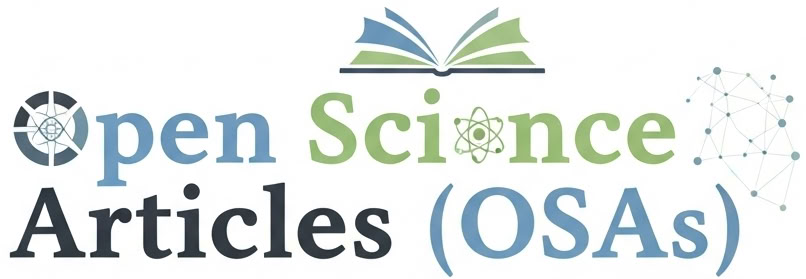
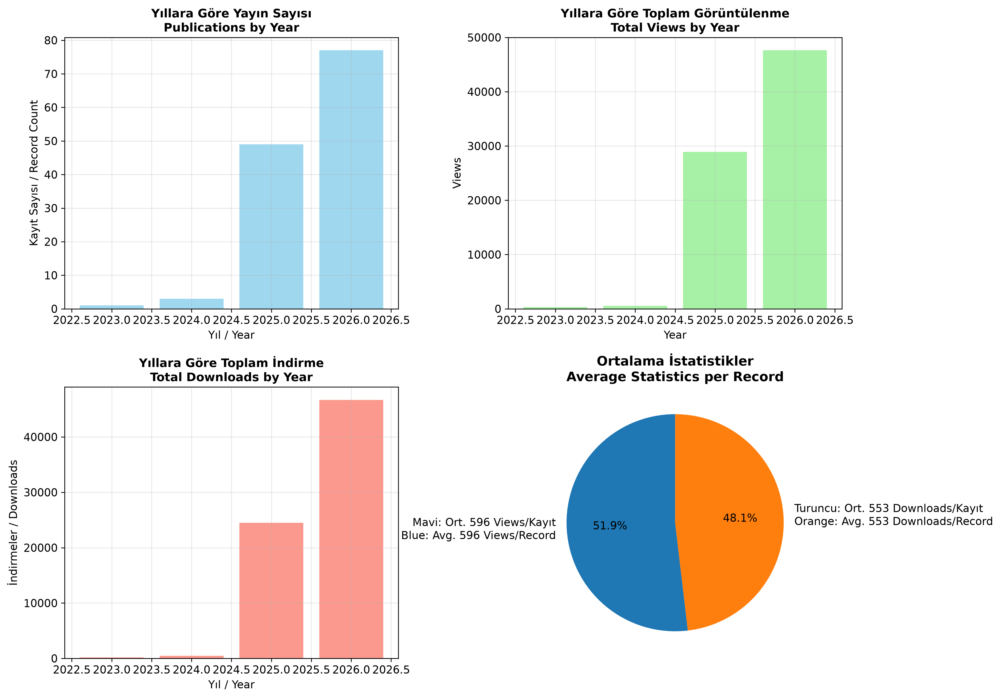

# 📘 Open Science Articles (OSAs): Open Sci. Artic.(OSAs)

---

### [Open Science Articles (OSAs) Community Link](https://zenodo.org/communities/bilginomi/records)

---

# OSAs 

---
<h2>📊 Open Science Articles (OSAs) Community / Açık Bilim Makaleleri (ABMr) Topluluğu</h2>
<p><strong>Last Updated / Güncellenme Zamanı:</strong> 2026-10-30</p>

| İngilizce / English | Türkçe / Turkish |
|---------------------|------------------|
| **📊 Open Science Articles (OSAs) Community**<br>**Last Updated:** 2026-10-30<br><br>**📦 General Statistics**<br>- **Total Number of Articles:** 130<br>- **Total Views:** 77435<br>- **Total Downloads:** 71852 | **📊 Açık Bilim Makaleleri (ABMr) Topluluğu**<br>**Güncellenme Zamanı:** 2026-10-30<br><br>**📦 Genel İstatistikler**<br>- **Toplam Makale Sayısı:** 130<br>- **Toplam Görüntülenme:** 77435<br>- **Toplam İndirme:** 71852 |

---

| Year / Yıl | Publications / Yayın Sayısı | Total Views / Toplam Views | Total Downloads / Toplam Downloads | Avg Views per Publication / Ort. Views/Yayın | Avg Downloads per Publication / Ort. Downloads/Yayın |
|------------|-----------------------------|----------------------------|------------------------------------|---------------------------------------------|----------------------------------------------------|
| 2023      | 1                           | 337                       | 180                                | 337                                  | 180                                       |
| 2024      | 3                           | 558                       | 483                               | 186                                  | 161                                        |
| 2025      | 49                          | 28918                     | 24512                            | 590.2                                  | 500.2                                        |
| 2026      | 77                         | 47622                    | 46677                            | 618.5                                  | 606.2                                      |



---

### ⚠️ Science Should Be Free for All

Open Science Articles (OSAs) ensure that research is freely available to everyone. Removing paywalls promotes wider access to knowledge, encourages collaboration, and accelerates innovation. By making scientific findings publicly accessible, we empower communities, support education, and foster global progress.

---
### 📝 Review policy

All submissions to the community undergo a mandatory peer-review process. This scholarly evaluation ensures that contributions meet academic standards, maintain scientific accuracy, and add value to the field of study.

---

### 📝 Curation Policy: Only Scientific Fields

This policy aims to focus exclusively on content related to scientific fields. It includes information directly connected to scientific research, theories, concepts, and methods. However, content lacking a scientific basis or relying on speculative discussions is excluded.

Scientific fields may include disciplines such as physics, chemistry, biology, mathematics, astronomy, engineering, and social sciences.

This curation policy is enforced to ensure scientific accuracy, maintain evidence-based discussions, and preserve the reliability of the presented data.

---

### 📊 Summary Table

The table below provides an overview of the main sections typically included in a scientific publication, along with their usual word ranges:

| Section             | Description                                      | Word Range        |
|---------------------|--------------------------------------------------|-------------------|
| Orcid ID            | Mandatory for each author                        | -                 |
| Title               | Concise title reflecting the study               | 8–15 words        |
| Abstract            | Summary of the study                             | 150–250 words     |
| Keywords            | Key terms related to the topic                   | 4–8 words/phrases |
| Introduction        | Purpose and significance of the study            | 300–600 words     |
| Methods             | Research methods                                 | 500–1000 words    |
| Results             | Findings of the research                         | 300–800 words     |
| Discussion          | Interpretation of findings                       | 500–1000 words    |
| Conclusion          | Main conclusions and suggestions                 | 150–300 words     |
| Acknowledgments     | Acknowledgment of contributors                   | 50–150 words      |
| References          | Cited references                                 | Variable (10–50)  |
| Appendices (Optional) | Additional information                        | Variable          |

> **Note:** Different journals or disciplines may adjust these word ranges slightly; however, the overall structure generally remains consistent.

---

### ⚠️ Note: Old Published Articles

Please apply the following updates:

- Remove old publication and DOI details from the header.
- Delete the old DOI information from the title.
- Please include this information in the references section.

---
---

## 📘 Open Science Articles (OSAs): Açık Bilim Makaleleri (ABMr)

### [Open Science Articles (OSAs): Açık Bilim Makaleleri (ABMr) Topluluk Linki](https://zenodo.org/communities/bilginomi/records)

---
### ⚠️ Bilimsel Bilgi Herkese Açık Olmalı

Bilimsel ilerleme toplumun ortak mirasıdır. Açık Bilim Makaleleri (ABMr), araştırmaların tüm dünyaya açık, ücretsiz ve engelsiz olarak erişilebilmesini sağlar. Bu sayede öğrenciler, araştırmacılar ve meraklıları bilgiye doğrudan ulaşabilir, yenilik teşviki artar ve toplumsal fayda maksimize edilir.

---
### 📝 Hakemlik Süreci

Topluluğa sunulan tüm makaleler zorunlu bir hakemlik sürecine tabidir. Bu akademik değerlendirme süreci, katkıların bilimsel standartlara uygun olduğunu, verilerin güvenilir olduğunu ve alan için değer katıldığını garanti altına alır.

---

### 📝 Curation Policy: Only Scientific Fields

Bu politika, yalnızca bilimsel alanlara odaklanmayı amaçlamaktadır. Bilimsel araştırma, teoriler, kavramlar ve yöntemlerle doğrudan ilişkili olan bilgileri kapsar. Ancak bilimsel temeli olmayan ya da spekülatif tartışmalara dayanan içerikler dışlanmaktadır.

Bilimsel alanlar arasında fizik, kimya, biyoloji, matematik, astronomi, mühendislik ve sosyal bilimler gibi birçok disiplin yer almaktadır.

Bu curation politikası, bilimsel doğruluğun sağlanması, kanıtlara dayalı tartışmaların sürdürülmesi ve sunulan verilerin güvenilirliğinin korunması amacıyla uygulanmaktadır.

---

### 📊 Summary Table

Aşağıdaki tablo, bilimsel bir yayında yer alması beklenen ana bölümleri ve bunların tipik kelime aralıklarını özetlemektedir:

| Section             | Description                                      | Word Range        |
|---------------------|--------------------------------------------------|-------------------|
| Orcid ID            | Her yazar için zorunludur                      | -                 |
| Title               | Çalışmayı yansıtan kısa başlık                 | 8–15 words        |
| Abstract            | Çalışmanın özeti                               | 150–250 words     |
| Keywords            | Konuyla ilgili anahtar kelimeler               | 4–8 words/phrases |
| Introduction        | Çalışmanın amacı ve önemi                      | 300–600 words     |
| Methods             | Araştırmanın yöntemi                           | 500–1000 words    |
| Results             | Araştırmanın bulguları                         | 300–800 words     |
| Discussion          | Bulguların yorumu                              | 500–1000 words    |
| Conclusion          | Temel sonuçlar ve öneriler                    | 150–300 words     |
| Acknowledgments     | Katkıda bulunanlara teşekkür                   | 50–150 words      |
| References          | Alıntılanan kaynaklar                          | Variable (10–50)  |
| Appendices (Optional) | Ek bilgi veya veriler                        | Variable          |

> **Not:** Farklı dergiler veya disiplinler bu kelime aralıklarında değişiklik yapabilir; ancak temel yapı genellikle aynı kalır.

---

### ⚠️ Note: Old Published Articles

Lütfen aşağıdaki düzenlemeleri yapınız:

- Eski yayın ve DOI bilgilerini başlıktan kaldırınız.
- Eski DOI bilgisini başlıkta da siliniz.
- Bu bilgileri lütfen referanslar bölümüne ekleyiniz.
  
---

**Google Scholar:  Open Science Articles (OSAs)**

https://scholar.google.com/citations?hl=en&user=oCzePg4AAAAJ

---

### 📘 Published Articles

## 📰 Yayınlanan Makaleler

Total 130 publications found: Toplam 130 yayın bulundu.

1. NV Merkezlerinde Kesirli Kuantum Bellek Tespiti: Model Seçimi, SNR ve Protokol Sayısı Kriterler https://doi.org/10.5281/zenodo.23751138
2. mlfp https://doi.org/10.5281/zenodo.23549172
3. Kesirli Kuantum Dinamiği Altında Stratum Mimarisi: NV-Weyl-Majorana Karma Sistemlerinde Topolojik Koruma, Kuantum Hata Düzeltme ve Işınlanma https://doi.org/10.5281/zenodo.23605556
4. Mittag-Leffler ve Prabhakar Fonksiyonlarının Python'da Güvenli ve Doğru Hesaplanması https://doi.org/10.5281/zenodo.23550352
5. Kare Kafes t-J Modelinden Topolojik Majorana Modlarına: Güçlü Korelasyonlu Elektron Sistemlerinde Spin-Yük Ayrışmasının Kuantum Örgü Simülasyonu https://doi.org/10.5281/zenodo.23488782
6. Gelecek Nesil Yapay Zeka Sistemleri için Bellek Mimarilerinde Paradigma Değişimi https://doi.org/10.5281/zenodo.23463618
7. From Quantum Beats to Topological Protection: A Stratum-Based Hybrid Architecture Integrating NV Centers, Weyl Interfaces, and Majorana Qubits for Fault-Tolerant Quantum Computing https://doi.org/10.5281/zenodo.23427142
8. Understanding Quantum Mechanics through Hilbert Spaces: Applications in Quantum Computing https://doi.org/10.5281/zenodo.15468754
9. Grikod3 https://doi.org/10.5281/zenodo.23422956
10. Hilbert Uzayları Üzerinden Kuantum Mekaniğini Anlamak: Kuantum Hesaplamada Uygulamalar https://doi.org/10.5281/zenodo.19221265
11. Kuantum Atımlarından Topolojik Korumaya: Hata Toleranslı Kuantum Hesaplama İçin NV Merkezleri, Weyl Arayüzleri ve Majorana Kübitlerini Bütünleştiren Stratum Tabanlı Karma Mimari https://doi.org/10.5281/zenodo.23349901
12. Nano Yapılı Magnetooptik Granatların Entegre Kuantum Fotonikteki Rolü: İnce Film Büyütme, Fotonik Kristal Tasarımı ve Çip Ölçeğinde Kuantum Transdüksiyon https://doi.org/10.5281/zenodo.23328331
13. Applications and Significance of Magneto-Optical Garnets in Quantum Computing and the Quantum Internet https://doi.org/10.5281/zenodo.23308278
14. Magnetooptik Granatların Kuantum Bilgisayarlar ve Kuantum İnternet Alanındaki Kullanımı ve Önemi https://doi.org/10.5281/zenodo.23289589
15. A Novel Tool for Graph Theory Education: Interactive Exploration of the Hamiltonian Problem with Z3 and the Keçeci Layout https://doi.org/10.5281/zenodo.16920991
16. Sınırdaki Paradigma Değişimi: Kuantum Tünelleme Bariyerinden Karbon Nanotüplere ve Hesaplama Gücüne Uzanan Kuantum Limitleri https://doi.org/10.5281/zenodo.23267798
17. r3cal: Çok Dilli, Gömülebilir ve Standartlara Uygun Bir Direnç Renk Kodu Hesaplayıcı Kütüphanesi https://doi.org/10.5281/zenodo.23251543
18. Dynamic vs Static Number Sequences: The Case of Keçeci and Oresme Numbers https://doi.org/10.5281/zenodo.15833351
19. Non-Lineer Alan Teorilerinden Topolojik Kuantum Hesaplamaya Karma Ardaşık Düzen Modellemesi ve Verimlilik Analizi https://doi.org/10.5281/zenodo.23096427
20. Stratum Model Animation https://doi.org/10.5281/zenodo.22012671
21. Weyl–Süperiletken Heteroyapılarda Topolojik Arayüz Mühendisliği: Stratum Modeli ile Ortaya Çıkan Majorana Yayları, Non-Abelian Örgüleme ve K‑Teorisi Sınıflandırması https://doi.org/10.5281/zenodo.21908118
22. From Feeble Signals to Intense X-rays: Physical Foundations, Technological Applications, and Future Perspectives of Amplification https://doi.org/10.5281/zenodo.21235074
23. Zayıf Sinyallerden Güçlü X-Işınlarına: Amplifikasyonun Fiziksel Temelleri, Teknolojik Uygulamaları ve Gelecek Perspektifleri https://doi.org/10.5281/zenodo.21137301
24. oresmen https://doi.org/10.5281/zenodo.16634186
25. oresmej https://doi.org/10.5281/zenodo.15874178
26. Oresme https://doi.org/10.5281/zenodo.15833238
27. Weyl Semimetals: Discovery of Exotic Electronic States and Topological Phases https://doi.org/10.5281/zenodo.15447116
28. kececilayout https://doi.org/10.5281/zenodo.15313946
29. kececinumbers https://doi.org/10.5281/zenodo.15377659
30. Keçeci Varsayımı: Collatz Genelleştirmesi Olarak Çoklu Cebirsel Sistemlerde Yinelemeli Dinamikler https://doi.org/10.5281/zenodo.16702475
31. Keçeci Eğrisi Âilesinin Yerellik Performansı ve Kuantum Durum Simülasyonlarındaki Uygulamaları https://doi.org/10.5281/zenodo.20263326
32. KHA-256 https://doi.org/10.5281/zenodo.18089401
33. kececisquares https://doi.org/10.5281/zenodo.15411670
34. kececicurve https://doi.org/10.5281/zenodo.19696338
35. Space-Filling Curves for Quantum Computing: From Molecular Simulations to Error Correction https://doi.org/10.5281/zenodo.19793852
36. Keçeci Eğrisi: Dairesel Temelli Parametrik Bir Uzay Doldurma Eğrisi Âilesi https://doi.org/10.5281/zenodo.19796065
37. Kuantum Hesaplamada Uzay Dolduran Eğriler: Moleküler Simülasyonlardan Hata Düzeltmeye https://doi.org/10.5281/zenodo.19666944
38. Keçeci Curve: A Circular-Based Parametric Space-Filling Curve Family https://doi.org/10.5281/zenodo.19885259
39. spacecurves https://doi.org/10.5281/zenodo.19672791
40. Nodal-Line Semimetals: A Geometric Advantage in Quantum Information https://doi.org/10.5281/zenodo.15455271
41. From Majorana Fermions to Quantum Devices: The Role of Nanomaterials in the Second Quantum Era https://doi.org/10.5281/zenodo.15331067
42. Ezan https://doi.org/10.5281/zenodo.18722150
43. A Thermodynamic Interpretation of the Vacuum Catastrophe via a Λ-Selected Quantum Scale https://doi.org/10.5281/zenodo.14581582
44. Tenth-Century Scholar Imam Ismail al-Jawhari: The Second Founder of Aerodynamics https://doi.org/10.5281/zenodo.18418431
45. The Keçeci-Fujii Model Derived from Akdeniz-Dane Model: 2n-Dimensional Instanton Solutions, Higher-Derivative Interactions and Quantum Information Applications https://doi.org/10.5281/zenodo.18399634
46. Akdeniz-Dane Modelinden Keçeci-Fujii Modeline: 2n-Boyutlu Instanton Çözümleri, Yüksek Türevli Etkileşimler ve Kuantum Bilgi Uygulamaları https://doi.org/10.5281/zenodo.18399540
47. 2n-Boyutlu Fujii Modelinde Instanton Benzeri Çözümler ve Yüksek Türevli Instantonlar Arasındaki Kuplaj Sabitinin Rolü https://doi.org/10.5281/zenodo.18398161
48. Microbenchmark Performance Analysis: Python 3.15.0a3 vs 3.11.14 https://doi.org/10.5281/zenodo.18355481
49. Python 3.15.0a3 ve 3.11.14 Mikrobenchmark Performans Analizi https://doi.org/10.5281/zenodo.18355457
50. kececifractals https://doi.org/10.5281/zenodo.15392518
51. Modeling Wave Scattering with Keçeci Fractals https://doi.org/10.5281/zenodo.18361849
52. Keçeci Fraktalları ile Dalga Saçılmasının Modellenmesi https://doi.org/10.5281/zenodo.18359915
53. adnus https://doi.org/10.5281/zenodo.16341919
54. Grikod2 https://doi.org/10.5281/zenodo.15352206
55. Onuncu Yüzyıl Âlimi İmâm İsmâil el-Cevherî: Aerodinamik Biliminin İkinci Kurucusu https://doi.org/10.5281/zenodo.18217812
56. KHA-256: A Next-Generation Cryptographic Hash Function Based on Keçeci Numbers and Mathematical Constants https://doi.org/10.5281/zenodo.18156885
57. Kuantum Hesaplamada Doğruluk, Gürültü ve Ölçeklenebilirlik: NISQ Çağı ve Ötesi için Stratejiler https://doi.org/10.5281/zenodo.17342849
58. Accuracy, Noise, and Scalability in Quantum Computation: Strategies for the NISQ Era and Beyond https://doi.org/10.5281/zenodo.15515113
59. From Chaos to Clarity: The Keçeci Layout for Order-Dependent Systems https://doi.org/10.5281/zenodo.17665770
60. Kuantum Hata Düzeltmede Metrik Seçimi ve Algoritmik Optimizasyonun Büyük Ölçekli Yüzey Kodları Üzerindeki Etkileri https://doi.org/10.5281/zenodo.15572200
61. The Impact of Metric Selection and Algorithmic Optimisation on Large-Scale Surface Codes in Quantum Error Correction https://doi.org/10.5281/zenodo.17259861
62. Quantum Error Correction Codes and Their Impact on Scalable Quantum Computation: Current Approaches and Future Perspectives https://doi.org/10.5281/zenodo.15499657
63. Kuantum Hata Düzeltme Kodlarının Tekâmülü ve Ölçeklenebilir Kuantum Hesaplamaya Etkileri: Güncel Yaklaşımlar ve Gelecek Perspektifleri https://doi.org/10.5281/zenodo.17328711
64. Nanoscale Quantum Computers Fundamentals, Technologies, and Future Perspectives https://doi.org/10.5281/zenodo.15493024
65. Nano Ölçekli Kuantum Bilgisayarlar: Temeller, Teknolojiler ve Gelecek Perspektifleri https://doi.org/10.5281/zenodo.17306511
66. Investigating Layered Structures Containing Weyl and Majorana Fermions via the Stratum Model https://doi.org/10.5281/zenodo.15489074
67. Weyl ve Majorana Fermiyonlarını İçeren Katmanlı Yapıların Stratum Modeli ile İncelenmesi https://doi.org/10.5281/zenodo.17295984
68. Çoklu İşlemci Mimarilerinde Kuantum Algoritma Simülasyonlarının Hızlandırılması: Cython, Numba ve Jax ile Optimizasyon Teknikleri https://doi.org/10.5281/zenodo.15580503
69. Accelerating Quantum Algorithm Simulations in Multi-Processor Architectures: Optimisation Techniques with Cython, Numba, and Jax https://doi.org/10.5281/zenodo.17287508
70. Kuantum Hata Düzeltme Algoritmalarında Özyineleme Optimizasyonu ve Aşırı Gürültü Toleransı: Kuantum Sıçraması Potansiyelinin Değerlendirilmesi https://doi.org/10.5281/zenodo.15570678
71. Recursion Optimisation and Extreme Noise Tolerance in Quantum Error Correction Algorithms: Assessing the Potential for a Quantum Leap https://doi.org/10.5281/zenodo.17243336
72. Yüksek Kübit Sayılı Kuantum Hesaplamada Ölçeklenebilirlik ve Hata Yönetimi: Yüzey Kodları, Topolojik Malzemeler ve Hibrit Algoritmik Yaklaşımlar https://doi.org/10.5281/zenodo.15558153
73. Scalability and Error Management in High-Qubit-Count Quantum Computing: Surface Codes, Topological Materials, and Hybrid Algorithmic Approaches https://doi.org/10.5281/zenodo.17227501
74. Error Minimisation in Autonomous and Convolutional Quantum Algorithms through Artificial Intelligence Integration in the Context of the Künneth Theorem https://doi.org/10.5281/zenodo.17214806
75. Künneth Teoremi Bağlamında Özdevinimli ve Evrişimli Kuantum Algoritmalarında Yapay Zekâ Entegrasyonu ile Hata Minimizasyonu https://doi.org/10.5281/zenodo.15540875
76. Characterization of Keçeci Number Systems as Chaotic and Hyperchaotic Maps https://doi.org/10.5281/zenodo.16954468
77. Deterministic Visualization of Distribution Power Grids: Integration of Power Grid Model and Keçeci Layout https://doi.org/10.5281/zenodo.16934620
78. Graf Teorisi Eğitiminde Yeni Bir Araç: Z3 ve Keçeci Dizilimi ile Hamilton Probleminin İnteraktif Keşfi https://doi.org/10.5281/zenodo.16883657
79. Kuantum Algoritmalarında Veri Kodlama ve Kuantizasyon Arasındaki İlişkinin Analizi ve Keçeci Layout ile Max-Cut Problemi https://doi.org/10.5281/zenodo.16755186
80. The Keçeci Layout: A Deterministic Visualisation Framework for the Structural Analysis of Ordered Systems in Chemistry and Environmental Science https://doi.org/10.5281/zenodo.16696713
81. Geometric Interpretations of Keçeci Numbers with Neutrosophic and Hyperreal Numbers https://doi.org/10.5281/zenodo.16344231
82. Keçeci Sayılarının Nötrosofik ve Hipergerçek Sayılarla Geometrik Yorumlamaları https://doi.org/10.5281/zenodo.16343568
83. A Comparative Study of Pure Python and JAX-Based Approaches in Computing Harmonic Series https://doi.org/10.5281/zenodo.16576092
84. Harmonik Serilerin Hesaplanmasında Saf Python ve JAX Tabanlı Yaklaşımların Karşılaştırılması https://doi.org/10.5281/zenodo.16536195
85. The Keçeci Layout: A Deterministic, Order-Preserving Visualization Algorithm for Structured Systems https://doi.org/10.5281/zenodo.16526798
86. The Keçeci Layout: A Structural Approach for Interdisciplinary Scientific Analysis https://doi.org/10.5281/zenodo.15792684
87. Kütleçekimsel Dalga Gözlemleri ile Kuantum Bilgisayar Teknolojileri Arasındaki Teknolojik ve Metodolojik Bağlantılar https://doi.org/10.5281/zenodo.15519591
88. The Relationship Between Gravitational Wave Observations and Quantum Computing Technologies https://doi.org/10.5281/zenodo.15524251
89. Scalable Complexity: Mathematical Analysis and Potential for Physical Applications of the Keçeci Circle Fractal https://doi.org/10.5281/zenodo.15392772
90. Keçeci Layout https://doi.org/10.5281/zenodo.15314328
91. The Keçeci Binomial Square: A Reinterpretation of the Standard Binomial Expansion and Its Potential Applications https://doi.org/10.5281/zenodo.15425529
92. Keçeci Numbers and the Keçeci Prime Number: A Potential Number Theoretic Exploratory Tool https://doi.org/10.5281/zenodo.15381697
93. Diversity of Keçeci Numbers and Their Application to Prešić-Type Fixed-Point Iterations: A Numerical Exploration https://doi.org/10.5281/zenodo.15481711
94. Kuantum Geometri, Topolojik Fazlar ve Yeni Matematiksel Yapılar: Disiplinlerarası Bir Perspektif https://doi.org/10.5281/zenodo.15474957
95. Grikod https://doi.org/10.5281/zenodo.12731345
96. Towards a New Ethos of Science or a Reform of the Institution of Science? Merton Revisited and the Prospects of Institutionalizing the Research Values of Openness and Mutual Responsiveness Bulunamadı
97. Using serinus canaria species in pet therapy sessions, related to geriatric patients https://doi.org/10.5281/zenodo.11094364
98. Unexpected synergies https://doi.org/10.5281/zenodo.11040008
99. Trastorno del neurodesarrollo relacionado con HNRNPH2 (Síndrome de Bain): perfil cognitivo, lingüístico y educativo en una enfermedad ultrarrara. https://doi.org/10.5281/zenodo.22258941
100. Quantum Spectrodynamics (QSD) https://doi.org/10.5281/zenodo.18832272
101. The K₇ Framework: Conditional Topological Relations for Standard-Model Parameters from G₂ Holonomy and E₈×E₈ Structure https://doi.org/10.5281/zenodo.16891489
102. A Horizon-Channel Partition of the Matter Sector https://doi.org/10.5281/zenodo.20788233
103. A Horizon Boundary Normalization of the Cosmological Constant https://doi.org/10.5281/zenodo.20572769
104. Neurogenetic profile, communication and educational intervention in students with CHD8 syndrome https://doi.org/10.5281/zenodo.20128219
105. Geometric Origin of Complex Wavefunctions: From the Spacetime Algebra Cl(1,3) to the Schrödinger Equation https://doi.org/10.5281/zenodo.19162378
106. Three Measurable Failure Modes of Large Language Models https://doi.org/10.5281/zenodo.20127317
107. A Syndrome Algebra for Differentiable Parametric Systems https://doi.org/10.5281/zenodo.20127536
108. Present Density Partition from a Fixed Horizon Boundary Relation https://doi.org/10.5281/zenodo.18727585
109. Algebraic Closure for the Gravitational Constant from Spherical Boundary Geometry https://doi.org/10.5281/zenodo.19207223
110. Geometric Regularization of the Friedmann Singularity from a Boundary Constraint https://doi.org/10.5281/zenodo.19186763
111. Hubble Horizon Area and Entropy from the Relation ΛR_H² = π³/15 https://doi.org/10.5281/zenodo.19136648
112. On Wave Function Collapse at Radiative Boundaries https://doi.org/10.5281/zenodo.18939162
113. Geometric Origin of Macroscopic Gravitational Normalization at Radiative Boundaries https://doi.org/10.5281/zenodo.18828287
114. Radiative Decoupling as a Boundary Condition: A Geometric Normalization from Stellar Photospheres to the Cosmic Horizon https://doi.org/10.5281/zenodo.18610638
115. Boundary Closure in Radiative-Gravitational Systems https://doi.org/10.5281/zenodo.18451447
116. A Boundary Closure Invariant Connecting Stellar Photospheres and the Friedmann Equation https://doi.org/10.5281/zenodo.18246417
117. An Empirical Photospheric Boundary Closure Relation from Detached Eclipsing Binaries https://doi.org/10.5281/zenodo.18226405
118. The Universal Equilibrium Constant (I = 4πGσ / c⁴) https://doi.org/10.5281/zenodo.17273671
119. Revisiting Wolf-Rayet Masses Through the Photogravitational Parameter Φ https://doi.org/10.5281/zenodo.17065080
120. World Quantum Theory: A Unified Framework for Quantum and Classical Physics from a Frequency Perspective https://doi.org/10.5281/zenodo.14279921
121. General Relativistic Extension of the Exponential Radius Law Near the Eddington Limit https://doi.org/10.5281/zenodo.16924625
122. Exponential Radius Evolution and Photogravitational Consistency in Near-Eddington Stars https://doi.org/10.5281/zenodo.16890577
123. A Single Collapse Threshold Linking Cosmology, Gravitation, and Decoherence: FE = 1 ⇐⇒ Senv = ℏ, Parameter-Free Predictions for CMB Peaks, Lensing, and Laboratory Tests https://doi.org/10.5281/zenodo.16809428
124. A Systematic Review and Meta-Analytical Assessment of Nanoparticle Applications in  Contaminated Water Treatment in Iraq (2010–2025) https://doi.org/10.5281/zenodo.16883050
125. From Eddington Saturation to Black Hole Horizons – A Unified Geometric Framework https://doi.org/10.5281/zenodo.16883747
126. AI-Driven Compliance Verification for Pharmaceutical Advertising: A Novel Approach Using Multi-Agent Systems https://doi.org/10.5281/zenodo.16330075
127. ODISTR – On Demand INTRANASAL STEROID THERAPY of Rajatsubhra: An Innovative Protocol for Pediatric Asthma Management https://doi.org/10.5281/zenodo.15872170
128. Spectral Coherence and Geometric Reformulation of the Riemann Hypothesis via Torsion-Free Vector Waves https://doi.org/10.5281/zenodo.15199433
129. A Unified Theoretical Framework Bridging Quantum Mechanics and Planetary Dynamics https://doi.org/10.5281/zenodo.15228525
130. Unveiling the Ultimate Theory of Planetary Genesis: A Mathematical Resolution Fully Interpreting the Solar System and Beyond https://doi.org/10.5281/zenodo.15209607

---
## BibTeX
---

```bibtex
@article {zenodo_23751138,
  author = {Keçeci, Mehmet},
  title = {NV Merkezlerinde Kesirli Kuantum Bellek Tespiti: Model Seçimi, SNR ve Protokol Sayısı Kriterler},
  year = {2026},
  publisher = {Zenodo},
  doi = {10.5281/zenodo.23751138},
  url = {https://zenodo.org/records/23751139},
  note = {Concept DOI: 10.5281/zenodo.23751138}
}

@software {zenodo_23549172,
  author = {Keçeci, Mehmet},
  title = {mlfp},
  year = {2026},
  publisher = {Zenodo},
  doi = {10.5281/zenodo.23549172},
  url = {https://zenodo.org/records/23741156},
  note = {Concept DOI: 10.5281/zenodo.23549172}
}

@article {zenodo_23605556,
  author = {Keçeci, Mehmet},
  title = {Kesirli Kuantum Dinamiği Altında Stratum Mimarisi: NV-Weyl-Majorana Karma Sistemlerinde Topolojik Koruma, Kuantum Hata Düzeltme ve Işınlanma},
  year = {2026},
  publisher = {Zenodo},
  doi = {10.5281/zenodo.23605556},
  url = {https://zenodo.org/records/23681756},
  note = {Concept DOI: 10.5281/zenodo.23605556}
}

@article {zenodo_23550352,
  author = {Keçeci, Mehmet},
  title = {Mittag-Leffler ve Prabhakar Fonksiyonlarının Python'da Güvenli ve Doğru Hesaplanması},
  year = {2026},
  publisher = {Zenodo},
  doi = {10.5281/zenodo.23550352},
  url = {https://zenodo.org/records/23550353},
  note = {Concept DOI: 10.5281/zenodo.23550352}
}

@article {zenodo_23488782,
  author = {Keçeci, Mehmet},
  title = {Kare Kafes t-J Modelinden Topolojik Majorana Modlarına: Güçlü Korelasyonlu Elektron Sistemlerinde Spin-Yük Ayrışmasının Kuantum Örgü Simülasyonu},
  year = {2026},
  publisher = {Zenodo},
  doi = {10.5281/zenodo.23488782},
  url = {https://zenodo.org/records/23488783},
  note = {Concept DOI: 10.5281/zenodo.23488782}
}

@article {zenodo_23463618,
  author = {Keçeci, Mehmet},
  title = {Gelecek Nesil Yapay Zeka Sistemleri için Bellek Mimarilerinde Paradigma Değişimi},
  year = {2026},
  publisher = {Zenodo},
  doi = {10.5281/zenodo.23463618},
  url = {https://zenodo.org/records/23463619},
  note = {Concept DOI: 10.5281/zenodo.23463618}
}

@article {zenodo_23427142,
  author = {Keçeci, Mehmet},
  title = {From Quantum Beats to Topological Protection: A Stratum-Based Hybrid Architecture Integrating NV Centers, Weyl Interfaces, and Majorana Qubits for Fault-Tolerant Quantum Computing},
  year = {2026},
  publisher = {Zenodo},
  doi = {10.5281/zenodo.23427142},
  url = {https://zenodo.org/records/23427143},
  note = {Concept DOI: 10.5281/zenodo.23427142}
}

@article {zenodo_15468754,
  author = {Keçeci, Mehmet},
  title = {Understanding Quantum Mechanics through Hilbert Spaces: Applications in Quantum Computing},
  year = {2026},
  publisher = {Zenodo},
  doi = {10.5281/zenodo.15468754},
  url = {https://zenodo.org/records/23423497},
  note = {Concept DOI: 10.5281/zenodo.15468754}
}

@software {zenodo_23422956,
  author = {Keçeci, Mehmet},
  title = {Grikod3},
  year = {2026},
  publisher = {Zenodo},
  doi = {10.5281/zenodo.23422956},
  url = {https://zenodo.org/records/23422957},
  note = {Concept DOI: 10.5281/zenodo.23422956}
}

@article {zenodo_19221265,
  author = {Keçeci, Mehmet},
  title = {Hilbert Uzayları Üzerinden Kuantum Mekaniğini Anlamak: Kuantum Hesaplamada Uygulamalar},
  year = {2026},
  publisher = {Zenodo},
  doi = {10.5281/zenodo.19221265},
  url = {https://zenodo.org/records/23406720},
  note = {Concept DOI: 10.5281/zenodo.19221265}
}

@article {zenodo_23349901,
  author = {Keçeci, Mehmet},
  title = {Kuantum Atımlarından Topolojik Korumaya: Hata Toleranslı Kuantum Hesaplama İçin NV Merkezleri, Weyl Arayüzleri ve Majorana Kübitlerini Bütünleştiren Stratum Tabanlı Karma Mimari},
  year = {2026},
  publisher = {Zenodo},
  doi = {10.5281/zenodo.23349901},
  url = {https://zenodo.org/records/23349902},
  note = {Concept DOI: 10.5281/zenodo.23349901}
}

@article {zenodo_23328331,
  author = {Keçeci, Mehmet},
  title = {Nano Yapılı Magnetooptik Granatların Entegre Kuantum Fotonikteki Rolü: İnce Film Büyütme, Fotonik Kristal Tasarımı ve Çip Ölçeğinde Kuantum Transdüksiyon},
  year = {2026},
  publisher = {Zenodo},
  doi = {10.5281/zenodo.23328331},
  url = {https://zenodo.org/records/23328332},
  note = {Concept DOI: 10.5281/zenodo.23328331}
}

@article {zenodo_23308278,
  author = {Keçeci, Mehmet},
  title = {Applications and Significance of Magneto-Optical Garnets in Quantum Computing and the Quantum Internet},
  year = {2026},
  publisher = {Zenodo},
  doi = {10.5281/zenodo.23308278},
  url = {https://zenodo.org/records/23308279},
  note = {Concept DOI: 10.5281/zenodo.23308278}
}

@article {zenodo_23289589,
  author = {Keçeci, Mehmet},
  title = {Magnetooptik Granatların Kuantum Bilgisayarlar ve Kuantum İnternet Alanındaki Kullanımı ve Önemi},
  year = {2026},
  publisher = {Zenodo},
  doi = {10.5281/zenodo.23289589},
  url = {https://zenodo.org/records/23289590},
  note = {Concept DOI: 10.5281/zenodo.23289589}
}

@article {zenodo_16920991,
  author = {Keçeci, Mehmet},
  title = {A Novel Tool for Graph Theory Education: Interactive Exploration of the Hamiltonian Problem with Z3 and the Keçeci Layout},
  year = {2026},
  publisher = {Zenodo},
  doi = {10.5281/zenodo.16920991},
  url = {https://zenodo.org/records/23271914},
  note = {Concept DOI: 10.5281/zenodo.16920991}
}

@article {zenodo_23267798,
  author = {Keçeci, Mehmet},
  title = {Sınırdaki Paradigma Değişimi: Kuantum Tünelleme Bariyerinden Karbon Nanotüplere ve Hesaplama Gücüne Uzanan Kuantum Limitleri},
  year = {2026},
  publisher = {Zenodo},
  doi = {10.5281/zenodo.23267798},
  url = {https://zenodo.org/records/23267799},
  note = {Concept DOI: 10.5281/zenodo.23267798}
}

@article {zenodo_23251543,
  author = {Keçeci, Mehmet},
  title = {r3cal: Çok Dilli, Gömülebilir ve Standartlara Uygun Bir Direnç Renk Kodu Hesaplayıcı Kütüphanesi},
  year = {2026},
  publisher = {Zenodo},
  doi = {10.5281/zenodo.23251543},
  url = {https://zenodo.org/records/23251544},
  note = {Concept DOI: 10.5281/zenodo.23251543}
}

@article {zenodo_15833351,
  author = {Keçeci, Mehmet},
  title = {Dynamic vs Static Number Sequences: The Case of Keçeci and Oresme Numbers},
  year = {2026},
  publisher = {Zenodo},
  doi = {10.5281/zenodo.15833351},
  url = {https://zenodo.org/records/23137739},
  note = {Concept DOI: 10.5281/zenodo.15833351}
}

@article {zenodo_23096427,
  author = {Keçeci, Mehmet},
  title = {Non-Lineer Alan Teorilerinden Topolojik Kuantum Hesaplamaya Karma Ardaşık Düzen Modellemesi ve Verimlilik Analizi},
  year = {2026},
  publisher = {Zenodo},
  doi = {10.5281/zenodo.23096427},
  url = {https://zenodo.org/records/23096428},
  note = {Concept DOI: 10.5281/zenodo.23096427}
}

@misc {zenodo_22012671,
  author = {Keçeci, Mehmet},
  title = {Stratum Model Animation},
  year = {2026},
  publisher = {Zenodo},
  doi = {10.5281/zenodo.22012671},
  url = {https://zenodo.org/records/22012672},
  note = {Concept DOI: 10.5281/zenodo.22012671}
}

@article {zenodo_21908118,
  author = {Keçeci, Mehmet},
  title = {Weyl–Süperiletken Heteroyapılarda Topolojik Arayüz Mühendisliği: Stratum Modeli ile Ortaya Çıkan Majorana Yayları, Non-Abelian Örgüleme ve K‑Teorisi Sınıflandırması},
  year = {2026},
  publisher = {Zenodo},
  doi = {10.5281/zenodo.21908118},
  url = {https://zenodo.org/records/21908119},
  note = {Concept DOI: 10.5281/zenodo.21908118}
}

@article {zenodo_21235074,
  author = {Keçeci, Mehmet},
  title = {From Feeble Signals to Intense X-rays: Physical Foundations, Technological Applications, and Future Perspectives of Amplification},
  year = {2026},
  publisher = {Zenodo},
  doi = {10.5281/zenodo.21235074},
  url = {https://zenodo.org/records/21508613},
  note = {Concept DOI: 10.5281/zenodo.21235074}
}

@article {zenodo_21137301,
  author = {Keçeci, Mehmet},
  title = {Zayıf Sinyallerden Güçlü X-Işınlarına: Amplifikasyonun Fiziksel Temelleri, Teknolojik Uygulamaları ve Gelecek Perspektifleri},
  year = {2026},
  publisher = {Zenodo},
  doi = {10.5281/zenodo.21137301},
  url = {https://zenodo.org/records/21508432},
  note = {Concept DOI: 10.5281/zenodo.21137301}
}

@software {zenodo_16634186,
  author = {Keçeci, Mehmet},
  title = {oresmen},
  year = {2026},
  publisher = {Zenodo},
  doi = {10.5281/zenodo.16634186},
  url = {https://zenodo.org/records/20625810},
  note = {Concept DOI: 10.5281/zenodo.16634186}
}

@software {zenodo_15874178,
  author = {Keçeci, Mehmet},
  title = {oresmej},
  year = {2026},
  publisher = {Zenodo},
  doi = {10.5281/zenodo.15874178},
  url = {https://zenodo.org/records/20625777},
  note = {Concept DOI: 10.5281/zenodo.15874178}
}

@software {zenodo_15833238,
  author = {Keçeci, Mehmet},
  title = {Oresme},
  year = {2026},
  publisher = {Zenodo},
  doi = {10.5281/zenodo.15833238},
  url = {https://zenodo.org/records/20625710},
  note = {Concept DOI: 10.5281/zenodo.15833238}
}

@article {zenodo_15447116,
  author = {Keçeci, Mehmet},
  title = {Weyl Semimetals: Discovery of Exotic Electronic States and Topological Phases},
  year = {2026},
  publisher = {Zenodo},
  doi = {10.5281/zenodo.15447116},
  url = {https://zenodo.org/records/20475091},
  note = {Concept DOI: 10.5281/zenodo.15447116}
}

@software {zenodo_15313946,
  author = {Keçeci, Mehmet},
  title = {kececilayout},
  year = {2026},
  publisher = {Zenodo},
  doi = {10.5281/zenodo.15313946},
  url = {https://zenodo.org/records/20474897},
  note = {Concept DOI: 10.5281/zenodo.15313946}
}

@software {zenodo_15377659,
  author = {Keçeci, Mehmet},
  title = {kececinumbers},
  year = {2026},
  publisher = {Zenodo},
  doi = {10.5281/zenodo.15377659},
  url = {https://zenodo.org/records/20396949},
  note = {Concept DOI: 10.5281/zenodo.15377659}
}

@article {zenodo_16702475,
  author = {Keçeci, Mehmet},
  title = {Keçeci Varsayımı: Collatz Genelleştirmesi Olarak Çoklu Cebirsel Sistemlerde Yinelemeli Dinamikler},
  year = {2026},
  publisher = {Zenodo},
  doi = {10.5281/zenodo.16702475},
  url = {https://zenodo.org/records/20387111},
  note = {Concept DOI: 10.5281/zenodo.16702475}
}

@article {zenodo_20263326,
  author = {Keçeci, Mehmet},
  title = {Keçeci Eğrisi Âilesinin Yerellik Performansı ve Kuantum Durum Simülasyonlarındaki Uygulamaları},
  year = {2026},
  publisher = {Zenodo},
  doi = {10.5281/zenodo.20263326},
  url = {https://zenodo.org/records/20263327},
  note = {Concept DOI: 10.5281/zenodo.20263326}
}

@software {zenodo_18089401,
  author = {Keçeci, Mehmet},
  title = {KHA-256},
  year = {2026},
  publisher = {Zenodo},
  doi = {10.5281/zenodo.18089401},
  url = {https://zenodo.org/records/20240822},
  note = {Concept DOI: 10.5281/zenodo.18089401}
}

@software {zenodo_15411670,
  author = {Keçeci, Mehmet},
  title = {kececisquares},
  year = {2026},
  publisher = {Zenodo},
  doi = {10.5281/zenodo.15411670},
  url = {https://zenodo.org/records/20234648},
  note = {Concept DOI: 10.5281/zenodo.15411670}
}

@software {zenodo_19696338,
  author = {Keçeci, Mehmet},
  title = {kececicurve},
  year = {2026},
  publisher = {Zenodo},
  doi = {10.5281/zenodo.19696338},
  url = {https://zenodo.org/records/19920070},
  note = {Concept DOI: 10.5281/zenodo.19696338}
}

@article {zenodo_19793852,
  author = {Keçeci, Mehmet},
  title = {Space-Filling Curves for Quantum Computing: From Molecular Simulations to Error Correction},
  year = {2026},
  publisher = {Zenodo},
  doi = {10.5281/zenodo.19793852},
  url = {https://zenodo.org/records/19886117},
  note = {Concept DOI: 10.5281/zenodo.19793852}
}

@article {zenodo_19796065,
  author = {Keçeci, Mehmet},
  title = {Keçeci Eğrisi: Dairesel Temelli Parametrik Bir Uzay Doldurma Eğrisi Âilesi},
  year = {2026},
  publisher = {Zenodo},
  doi = {10.5281/zenodo.19796065},
  url = {https://zenodo.org/records/19885899},
  note = {Concept DOI: 10.5281/zenodo.19796065}
}

@article {zenodo_19666944,
  author = {Keçeci, Mehmet},
  title = {Kuantum Hesaplamada Uzay Dolduran Eğriler: Moleküler Simülasyonlardan Hata Düzeltmeye},
  year = {2026},
  publisher = {Zenodo},
  doi = {10.5281/zenodo.19666944},
  url = {https://zenodo.org/records/19885887},
  note = {Concept DOI: 10.5281/zenodo.19666944}
}

@article {zenodo_19885259,
  author = {Keçeci, Mehmet},
  title = {Keçeci Curve: A Circular-Based Parametric Space-Filling Curve Family},
  year = {2026},
  publisher = {Zenodo},
  doi = {10.5281/zenodo.19885259},
  url = {https://zenodo.org/records/19885260},
  note = {Concept DOI: 10.5281/zenodo.19885259}
}

@software {zenodo_19672791,
  author = {Keçeci, Mehmet},
  title = {spacecurves},
  year = {2026},
  publisher = {Zenodo},
  doi = {10.5281/zenodo.19672791},
  url = {https://zenodo.org/records/19686740},
  note = {Concept DOI: 10.5281/zenodo.19672791}
}

@article {zenodo_15455271,
  author = {Keçeci, Mehmet},
  title = {Nodal-Line Semimetals: A Geometric Advantage in Quantum Information},
  year = {2026},
  publisher = {Zenodo},
  doi = {10.5281/zenodo.15455271},
  url = {https://zenodo.org/records/19041713},
  note = {Concept DOI: 10.5281/zenodo.15455271}
}

@article {zenodo_15331067,
  author = {Keçeci, Mehmet},
  title = {From Majorana Fermions to Quantum Devices: The Role of Nanomaterials in the Second Quantum Era},
  year = {2026},
  publisher = {Zenodo},
  doi = {10.5281/zenodo.15331067},
  url = {https://zenodo.org/records/18755206},
  note = {Concept DOI: 10.5281/zenodo.15331067}
}

@software {zenodo_18722150,
  author = {Keçeci, Mehmet},
  title = {Ezan},
  year = {2026},
  publisher = {Zenodo},
  doi = {10.5281/zenodo.18722150},
  url = {https://zenodo.org/records/18722151},
  note = {Concept DOI: 10.5281/zenodo.18722150}
}

@article {zenodo_14581582,
  author = {Perera, Rajith and Valamontes Center For Scientific Publication},
  title = {A Thermodynamic Interpretation of the Vacuum Catastrophe via a Λ-Selected Quantum Scale},
  year = {2026},
  publisher = {Zenodo},
  doi = {10.5281/zenodo.14581582},
  url = {https://zenodo.org/records/18492119},
  note = {Concept DOI: 10.5281/zenodo.14581582}
}

@article {zenodo_18418431,
  author = {Keçeci, Mehmet},
  title = {Tenth-Century Scholar Imam Ismail al-Jawhari: The Second Founder of Aerodynamics},
  year = {2026},
  publisher = {Zenodo},
  doi = {10.5281/zenodo.18418431},
  url = {https://zenodo.org/records/18459029},
  note = {Concept DOI: 10.5281/zenodo.18418431}
}

@article {zenodo_18399634,
  author = {Keçeci, Mehmet},
  title = {The Keçeci-Fujii Model Derived from Akdeniz-Dane Model: 2n-Dimensional Instanton Solutions, Higher-Derivative Interactions and Quantum Information Applications},
  year = {2026},
  publisher = {Zenodo},
  doi = {10.5281/zenodo.18399634},
  url = {https://zenodo.org/records/18399635},
  note = {Concept DOI: 10.5281/zenodo.18399634}
}

@article {zenodo_18399540,
  author = {Keçeci, Mehmet},
  title = {Akdeniz-Dane Modelinden Keçeci-Fujii Modeline: 2n-Boyutlu Instanton Çözümleri, Yüksek Türevli Etkileşimler ve Kuantum Bilgi Uygulamaları},
  year = {2026},
  publisher = {Zenodo},
  doi = {10.5281/zenodo.18399540},
  url = {https://zenodo.org/records/18399541},
  note = {Concept DOI: 10.5281/zenodo.18399540}
}

@article {zenodo_18398161,
  author = {Keçeci, Mehmet},
  title = {2n-Boyutlu Fujii Modelinde Instanton Benzeri Çözümler ve Yüksek Türevli Instantonlar Arasındaki Kuplaj Sabitinin Rolü},
  year = {2026},
  publisher = {Zenodo},
  doi = {10.5281/zenodo.18398161},
  url = {https://zenodo.org/records/18398162},
  note = {Concept DOI: 10.5281/zenodo.18398161}
}

@article {zenodo_18355481,
  author = {Keçeci, Mehmet},
  title = {Microbenchmark Performance Analysis: Python 3.15.0a3 vs 3.11.14},
  year = {2026},
  publisher = {Zenodo},
  doi = {10.5281/zenodo.18355481},
  url = {https://zenodo.org/records/18383057},
  note = {Concept DOI: 10.5281/zenodo.18355481}
}

@article {zenodo_18355457,
  author = {Keçeci, Mehmet},
  title = {Python 3.15.0a3 ve 3.11.14 Mikrobenchmark Performans Analizi},
  year = {2026},
  publisher = {Zenodo},
  doi = {10.5281/zenodo.18355457},
  url = {https://zenodo.org/records/18382914},
  note = {Concept DOI: 10.5281/zenodo.18355457}
}

@software {zenodo_15392518,
  author = {Keçeci, Mehmet},
  title = {kececifractals},
  year = {2026},
  publisher = {Zenodo},
  doi = {10.5281/zenodo.15392518},
  url = {https://zenodo.org/records/18377683},
  note = {Concept DOI: 10.5281/zenodo.15392518}
}

@misc {zenodo_18361849,
  author = {Keçeci, Mehmet},
  title = {Modeling Wave Scattering with Keçeci Fractals},
  year = {2026},
  publisher = {Zenodo},
  doi = {10.5281/zenodo.18361849},
  url = {https://zenodo.org/records/18361850},
  note = {Concept DOI: 10.5281/zenodo.18361849}
}

@misc {zenodo_18359915,
  author = {Keçeci, Mehmet},
  title = {Keçeci Fraktalları ile Dalga Saçılmasının Modellenmesi},
  year = {2026},
  publisher = {Zenodo},
  doi = {10.5281/zenodo.18359915},
  url = {https://zenodo.org/records/18361511},
  note = {Concept DOI: 10.5281/zenodo.18359915}
}

@software {zenodo_16341919,
  author = {Keçeci, Mehmet},
  title = {adnus},
  year = {2026},
  publisher = {Zenodo},
  doi = {10.5281/zenodo.16341919},
  url = {https://zenodo.org/records/18264151},
  note = {Concept DOI: 10.5281/zenodo.16341919}
}

@software {zenodo_15352206,
  author = {Keçeci, Mehmet},
  title = {Grikod2},
  year = {2026},
  publisher = {Zenodo},
  doi = {10.5281/zenodo.15352206},
  url = {https://zenodo.org/records/18237634},
  note = {Concept DOI: 10.5281/zenodo.15352206}
}

@article {zenodo_18217812,
  author = {Keçeci, Mehmet},
  title = {Onuncu Yüzyıl Âlimi İmâm İsmâil el-Cevherî: Aerodinamik Biliminin İkinci Kurucusu},
  year = {2026},
  publisher = {Zenodo},
  doi = {10.5281/zenodo.18217812},
  url = {https://zenodo.org/records/18226950},
  note = {Concept DOI: 10.5281/zenodo.18217812}
}

@article {zenodo_18156885,
  author = {Keçeci, Mehmet},
  title = {KHA-256: A Next-Generation Cryptographic Hash Function Based on Keçeci Numbers and Mathematical Constants},
  year = {2026},
  publisher = {Zenodo},
  doi = {10.5281/zenodo.18156885},
  url = {https://zenodo.org/records/18156886},
  note = {Concept DOI: 10.5281/zenodo.18156885}
}

@article {zenodo_17342849,
  author = {Keçeci, Mehmet},
  title = {Kuantum Hesaplamada Doğruluk, Gürültü ve Ölçeklenebilirlik: NISQ Çağı ve Ötesi için Stratejiler},
  year = {2026},
  publisher = {Zenodo},
  doi = {10.5281/zenodo.17342849},
  url = {https://zenodo.org/records/18133843},
  note = {Concept DOI: 10.5281/zenodo.17342849}
}

@article {zenodo_15515113,
  author = {Keçeci, Mehmet},
  title = {Accuracy, Noise, and Scalability in Quantum Computation: Strategies for the NISQ Era and Beyond},
  year = {2026},
  publisher = {Zenodo},
  doi = {10.5281/zenodo.15515113},
  url = {https://zenodo.org/records/18133303},
  note = {Concept DOI: 10.5281/zenodo.15515113}
}

@article {zenodo_17665770,
  author = {Keçeci, Mehmet},
  title = {From Chaos to Clarity: The Keçeci Layout for Order-Dependent Systems},
  year = {2025},
  publisher = {Zenodo},
  doi = {10.5281/zenodo.17665770},
  url = {https://zenodo.org/records/17665771},
  note = {Concept DOI: 10.5281/zenodo.17665770}
}

@article {zenodo_15572200,
  author = {Keçeci, Mehmet},
  title = {Kuantum Hata Düzeltmede Metrik Seçimi ve Algoritmik Optimizasyonun Büyük Ölçekli Yüzey Kodları Üzerindeki Etkileri},
  year = {2025},
  publisher = {Zenodo},
  doi = {10.5281/zenodo.15572200},
  url = {https://zenodo.org/records/17660015},
  note = {Concept DOI: 10.5281/zenodo.15572200}
}

@article {zenodo_17259861,
  author = {Keçeci, Mehmet},
  title = {The Impact of Metric Selection and Algorithmic Optimisation on Large-Scale Surface Codes in Quantum Error Correction},
  year = {2025},
  publisher = {Zenodo},
  doi = {10.5281/zenodo.17259861},
  url = {https://zenodo.org/records/17659789},
  note = {Concept DOI: 10.5281/zenodo.17259861}
}

@article {zenodo_15499657,
  author = {Keçeci, Mehmet},
  title = {Quantum Error Correction Codes and Their Impact on Scalable Quantum Computation: Current Approaches and Future Perspectives},
  year = {2025},
  publisher = {Zenodo},
  doi = {10.5281/zenodo.15499657},
  url = {https://zenodo.org/records/17328737},
  note = {Concept DOI: 10.5281/zenodo.15499657}
}

@article {zenodo_17328711,
  author = {Keçeci, Mehmet},
  title = {Kuantum Hata Düzeltme Kodlarının Tekâmülü ve Ölçeklenebilir Kuantum Hesaplamaya Etkileri: Güncel Yaklaşımlar ve Gelecek Perspektifleri},
  year = {2025},
  publisher = {Zenodo},
  doi = {10.5281/zenodo.17328711},
  url = {https://zenodo.org/records/17328712},
  note = {Concept DOI: 10.5281/zenodo.17328711}
}

@article {zenodo_15493024,
  author = {Keçeci, Mehmet},
  title = {Nanoscale Quantum Computers Fundamentals, Technologies, and Future Perspectives},
  year = {2025},
  publisher = {Zenodo},
  doi = {10.5281/zenodo.15493024},
  url = {https://zenodo.org/records/17306567},
  note = {Concept DOI: 10.5281/zenodo.15493024}
}

@article {zenodo_17306511,
  author = {Keçeci, Mehmet},
  title = {Nano Ölçekli Kuantum Bilgisayarlar: Temeller, Teknolojiler ve Gelecek Perspektifleri},
  year = {2025},
  publisher = {Zenodo},
  doi = {10.5281/zenodo.17306511},
  url = {https://zenodo.org/records/17306512},
  note = {Concept DOI: 10.5281/zenodo.17306511}
}

@article {zenodo_15489074,
  author = {Keçeci, Mehmet},
  title = {Investigating Layered Structures Containing Weyl and Majorana Fermions via the Stratum Model},
  year = {2025},
  publisher = {Zenodo},
  doi = {10.5281/zenodo.15489074},
  url = {https://zenodo.org/records/17296041},
  note = {Concept DOI: 10.5281/zenodo.15489074}
}

@article {zenodo_17295984,
  author = {Keçeci, Mehmet},
  title = {Weyl ve Majorana Fermiyonlarını İçeren Katmanlı Yapıların Stratum Modeli ile İncelenmesi},
  year = {2025},
  publisher = {Zenodo},
  doi = {10.5281/zenodo.17295984},
  url = {https://zenodo.org/records/17295985},
  note = {Concept DOI: 10.5281/zenodo.17295984}
}

@article {zenodo_15580503,
  author = {Keçeci, Mehmet},
  title = {Çoklu İşlemci Mimarilerinde Kuantum Algoritma Simülasyonlarının Hızlandırılması: Cython, Numba ve Jax ile Optimizasyon Teknikleri},
  year = {2025},
  publisher = {Zenodo},
  doi = {10.5281/zenodo.15580503},
  url = {https://zenodo.org/records/17287573},
  note = {Concept DOI: 10.5281/zenodo.15580503}
}

@article {zenodo_17287508,
  author = {Keçeci, Mehmet},
  title = {Accelerating Quantum Algorithm Simulations in Multi-Processor Architectures: Optimisation Techniques with Cython, Numba, and Jax},
  year = {2025},
  publisher = {Zenodo},
  doi = {10.5281/zenodo.17287508},
  url = {https://zenodo.org/records/17287509},
  note = {Concept DOI: 10.5281/zenodo.17287508}
}

@article {zenodo_15570678,
  author = {Keçeci, Mehmet},
  title = {Kuantum Hata Düzeltme Algoritmalarında Özyineleme Optimizasyonu ve Aşırı Gürültü Toleransı: Kuantum Sıçraması Potansiyelinin Değerlendirilmesi},
  year = {2025},
  publisher = {Zenodo},
  doi = {10.5281/zenodo.15570678},
  url = {https://zenodo.org/records/17243413},
  note = {Concept DOI: 10.5281/zenodo.15570678}
}

@article {zenodo_17243336,
  author = {Keçeci, Mehmet},
  title = {Recursion Optimisation and Extreme Noise Tolerance in Quantum Error Correction Algorithms: Assessing the Potential for a Quantum Leap},
  year = {2025},
  publisher = {Zenodo},
  doi = {10.5281/zenodo.17243336},
  url = {https://zenodo.org/records/17243337},
  note = {Concept DOI: 10.5281/zenodo.17243336}
}

@article {zenodo_15558153,
  author = {Keçeci, Mehmet},
  title = {Yüksek Kübit Sayılı Kuantum Hesaplamada Ölçeklenebilirlik ve Hata Yönetimi: Yüzey Kodları, Topolojik Malzemeler ve Hibrit Algoritmik Yaklaşımlar},
  year = {2025},
  publisher = {Zenodo},
  doi = {10.5281/zenodo.15558153},
  url = {https://zenodo.org/records/17227639},
  note = {Concept DOI: 10.5281/zenodo.15558153}
}

@article {zenodo_17227501,
  author = {Keçeci, Mehmet},
  title = {Scalability and Error Management in High-Qubit-Count Quantum Computing: Surface Codes, Topological Materials, and Hybrid Algorithmic Approaches},
  year = {2025},
  publisher = {Zenodo},
  doi = {10.5281/zenodo.17227501},
  url = {https://zenodo.org/records/17227502},
  note = {Concept DOI: 10.5281/zenodo.17227501}
}

@article {zenodo_17214806,
  author = {Keçeci, Mehmet},
  title = {Error Minimisation in Autonomous and Convolutional Quantum Algorithms through Artificial Intelligence Integration in the Context of the Künneth Theorem},
  year = {2025},
  publisher = {Zenodo},
  doi = {10.5281/zenodo.17214806},
  url = {https://zenodo.org/records/17214807},
  note = {Concept DOI: 10.5281/zenodo.17214806}
}

@article {zenodo_15540875,
  author = {Keçeci, Mehmet},
  title = {Künneth Teoremi Bağlamında Özdevinimli ve Evrişimli Kuantum Algoritmalarında Yapay Zekâ Entegrasyonu ile Hata Minimizasyonu},
  year = {2025},
  publisher = {Zenodo},
  doi = {10.5281/zenodo.15540875},
  url = {https://zenodo.org/records/17213755},
  note = {Concept DOI: 10.5281/zenodo.15540875}
}

@article {zenodo_16954468,
  author = {Keçeci, Mehmet},
  title = {Characterization of Keçeci Number Systems as Chaotic and Hyperchaotic Maps},
  year = {2025},
  publisher = {Zenodo},
  doi = {10.5281/zenodo.16954468},
  url = {https://zenodo.org/records/17128283},
  note = {Concept DOI: 10.5281/zenodo.16954468}
}

@article {zenodo_16934620,
  author = {Keçeci, Mehmet},
  title = {Deterministic Visualization of Distribution Power Grids: Integration of Power Grid Model and Keçeci Layout},
  year = {2025},
  publisher = {Zenodo},
  doi = {10.5281/zenodo.16934620},
  url = {https://zenodo.org/records/16934621},
  note = {Concept DOI: 10.5281/zenodo.16934620}
}

@article {zenodo_16883657,
  author = {Keçeci, Mehmet},
  title = {Graf Teorisi Eğitiminde Yeni Bir Araç: Z3 ve Keçeci Dizilimi ile Hamilton Probleminin İnteraktif Keşfi},
  year = {2025},
  publisher = {Zenodo},
  doi = {10.5281/zenodo.16883657},
  url = {https://zenodo.org/records/16922961},
  note = {Concept DOI: 10.5281/zenodo.16883657}
}

@article {zenodo_16755186,
  author = {Keçeci, Mehmet},
  title = {Kuantum Algoritmalarında Veri Kodlama ve Kuantizasyon Arasındaki İlişkinin Analizi ve Keçeci Layout ile Max-Cut Problemi},
  year = {2025},
  publisher = {Zenodo},
  doi = {10.5281/zenodo.16755186},
  url = {https://zenodo.org/records/16755187},
  note = {Concept DOI: 10.5281/zenodo.16755186}
}

@article {zenodo_16696713,
  author = {Keçeci, Mehmet},
  title = {The Keçeci Layout: A Deterministic Visualisation Framework for the Structural Analysis of Ordered Systems in Chemistry and Environmental Science},
  year = {2025},
  publisher = {Zenodo},
  doi = {10.5281/zenodo.16696713},
  url = {https://zenodo.org/records/16696714},
  note = {Concept DOI: 10.5281/zenodo.16696713}
}

@article {zenodo_16344231,
  author = {Keçeci, Mehmet},
  title = {Geometric Interpretations of Keçeci Numbers with Neutrosophic and Hyperreal Numbers},
  year = {2025},
  publisher = {Zenodo},
  doi = {10.5281/zenodo.16344231},
  url = {https://zenodo.org/records/16628068},
  note = {Concept DOI: 10.5281/zenodo.16344231}
}

@article {zenodo_16343568,
  author = {Keçeci, Mehmet},
  title = {Keçeci Sayılarının Nötrosofik ve Hipergerçek Sayılarla Geometrik Yorumlamaları},
  year = {2025},
  publisher = {Zenodo},
  doi = {10.5281/zenodo.16343568},
  url = {https://zenodo.org/records/16628067},
  note = {Concept DOI: 10.5281/zenodo.16343568}
}

@article {zenodo_16576092,
  author = {Keçeci, Mehmet},
  title = {A Comparative Study of Pure Python and JAX-Based Approaches in Computing Harmonic Series},
  year = {2025},
  publisher = {Zenodo},
  doi = {10.5281/zenodo.16576092},
  url = {https://zenodo.org/records/16627478},
  note = {Concept DOI: 10.5281/zenodo.16576092}
}

@article {zenodo_16536195,
  author = {Keçeci, Mehmet},
  title = {Harmonik Serilerin Hesaplanmasında Saf Python ve JAX Tabanlı Yaklaşımların Karşılaştırılması},
  year = {2025},
  publisher = {Zenodo},
  doi = {10.5281/zenodo.16536195},
  url = {https://zenodo.org/records/16627475},
  note = {Concept DOI: 10.5281/zenodo.16536195}
}

@article {zenodo_16526798,
  author = {Keçeci, Mehmet},
  title = {The Keçeci Layout: A Deterministic, Order-Preserving Visualization Algorithm for Structured Systems},
  year = {2025},
  publisher = {Zenodo},
  doi = {10.5281/zenodo.16526798},
  url = {https://zenodo.org/records/16526799},
  note = {Concept DOI: 10.5281/zenodo.16526798}
}

@article {zenodo_15792684,
  author = {Keçeci, Mehmet},
  title = {The Keçeci Layout: A Structural Approach for Interdisciplinary Scientific Analysis},
  year = {2025},
  publisher = {Zenodo},
  doi = {10.5281/zenodo.15792684},
  url = {https://zenodo.org/records/16115596},
  note = {Concept DOI: 10.5281/zenodo.15792684}
}

@article {zenodo_15519591,
  author = {Keçeci, Mehmet},
  title = {Kütleçekimsel Dalga Gözlemleri ile Kuantum Bilgisayar Teknolojileri Arasındaki Teknolojik ve Metodolojik Bağlantılar},
  year = {2025},
  publisher = {Zenodo},
  doi = {10.5281/zenodo.15519591},
  url = {https://zenodo.org/records/15784849},
  note = {Concept DOI: 10.5281/zenodo.15519591}
}

@article {zenodo_15524251,
  author = {Keçeci, Mehmet},
  title = {The Relationship Between Gravitational Wave Observations and Quantum Computing Technologies},
  year = {2025},
  publisher = {Zenodo},
  doi = {10.5281/zenodo.15524251},
  url = {https://zenodo.org/records/15784848},
  note = {Concept DOI: 10.5281/zenodo.15524251}
}

@article {zenodo_15392772,
  author = {Keçeci, Mehmet},
  title = {Scalable Complexity: Mathematical Analysis and Potential for Physical Applications of the Keçeci Circle Fractal},
  year = {2025},
  publisher = {Zenodo},
  doi = {10.5281/zenodo.15392772},
  url = {https://zenodo.org/records/15778442},
  note = {Concept DOI: 10.5281/zenodo.15392772}
}

@article {zenodo_15314328,
  author = {Keçeci, Mehmet},
  title = {Keçeci Layout},
  year = {2025},
  publisher = {Zenodo},
  doi = {10.5281/zenodo.15314328},
  url = {https://zenodo.org/records/15747336},
  note = {Concept DOI: 10.5281/zenodo.15314328}
}

@article {zenodo_15425529,
  author = {Keçeci, Mehmet},
  title = {The Keçeci Binomial Square: A Reinterpretation of the Standard Binomial Expansion and Its Potential Applications},
  year = {2025},
  publisher = {Zenodo},
  doi = {10.5281/zenodo.15425529},
  url = {https://zenodo.org/records/15711301},
  note = {Concept DOI: 10.5281/zenodo.15425529}
}

@article {zenodo_15381697,
  author = {Keçeci, Mehmet},
  title = {Keçeci Numbers and the Keçeci Prime Number: A Potential Number Theoretic Exploratory Tool},
  year = {2025},
  publisher = {Zenodo},
  doi = {10.5281/zenodo.15381697},
  url = {https://zenodo.org/records/15589625},
  note = {Concept DOI: 10.5281/zenodo.15381697}
}

@article {zenodo_15481711,
  author = {Keçeci, Mehmet},
  title = {Diversity of Keçeci Numbers and Their Application to Prešić-Type Fixed-Point Iterations: A Numerical Exploration},
  year = {2025},
  publisher = {Zenodo},
  doi = {10.5281/zenodo.15481711},
  url = {https://zenodo.org/records/15483569},
  note = {Concept DOI: 10.5281/zenodo.15481711}
}

@article {zenodo_15474957,
  author = {Keçeci, Mehmet},
  title = {Kuantum Geometri, Topolojik Fazlar ve Yeni Matematiksel Yapılar: Disiplinlerarası Bir Perspektif},
  year = {2025},
  publisher = {Zenodo},
  doi = {10.5281/zenodo.15474957},
  url = {https://zenodo.org/records/15477257},
  note = {Concept DOI: 10.5281/zenodo.15474957}
}

@software {zenodo_12731345,
  author = {Keçeci, Mehmet},
  title = {Grikod},
  year = {2025},
  publisher = {Zenodo},
  doi = {10.5281/zenodo.12731345},
  url = {https://zenodo.org/records/15351842},
  note = {Concept DOI: 10.5281/zenodo.12731345}
}

@article {zenodo_12731194,
  author = {Von schomberg, Rene},
  title = {Towards a New Ethos of Science or a Reform of the Institution of Science? Merton Revisited and the Prospects of Institutionalizing the Research Values of Openness and Mutual Responsiveness},
  year = {2024},
  publisher = {Zenodo},
  url = {https://zenodo.org/records/12731194},
}

@article {zenodo_11094364,
  author = {Leone, Pasquale},
  title = {Using serinus canaria species in pet therapy sessions, related to geriatric patients},
  year = {2023},
  publisher = {Zenodo},
  doi = {10.5281/zenodo.11094364},
  url = {https://zenodo.org/records/11094365},
  note = {Concept DOI: 10.5281/zenodo.11094364}
}

@article {zenodo_11040008,
  author = {Leone, Pasquale},
  title = {Unexpected synergies},
  year = {2024},
  publisher = {Zenodo},
  doi = {10.5281/zenodo.11040008},
  url = {https://zenodo.org/records/11040009},
  note = {Concept DOI: 10.5281/zenodo.11040008}
}

@article {zenodo_22258941,
  author = {López Martín, Sergio},
  title = {Trastorno del neurodesarrollo relacionado con HNRNPH2 (Síndrome de Bain): perfil cognitivo, lingüístico y educativo en una enfermedad ultrarrara.},
  year = {2026},
  publisher = {Zenodo},
  doi = {10.5281/zenodo.22258941},
  url = {https://zenodo.org/records/22258943},
  note = {Concept DOI: 10.5281/zenodo.22258941}
}

@article {zenodo_18832272,
  author = {Hubka, Marek},
  title = {Quantum Spectrodynamics (QSD)},
  year = {2026},
  publisher = {Zenodo},
  doi = {10.5281/zenodo.18832272},
  url = {https://zenodo.org/records/22161525},
  note = {Concept DOI: 10.5281/zenodo.18832272}
}

@article {zenodo_16891489,
  author = {de La Fournière, Brieuc},
  title = {The K₇ Framework: Conditional Topological Relations for Standard-Model Parameters from G₂ Holonomy and E₈×E₈ Structure},
  year = {2026},
  publisher = {Zenodo},
  doi = {10.5281/zenodo.16891489},
  url = {https://zenodo.org/records/21296168},
  note = {Concept DOI: 10.5281/zenodo.16891489}
}

@article {zenodo_20788233,
  author = {Bashan, Nadav},
  title = {A Horizon-Channel Partition of the Matter Sector},
  year = {2026},
  publisher = {Zenodo},
  doi = {10.5281/zenodo.20788233},
  url = {https://zenodo.org/records/20788368},
  note = {Concept DOI: 10.5281/zenodo.20788233}
}

@article {zenodo_20572769,
  author = {Bashan, Nadav},
  title = {A Horizon Boundary Normalization of the Cosmological Constant},
  year = {2026},
  publisher = {Zenodo},
  doi = {10.5281/zenodo.20572769},
  url = {https://zenodo.org/records/20680021},
  note = {Concept DOI: 10.5281/zenodo.20572769}
}

@article {zenodo_20128219,
  author = {López Martín, Sergio},
  title = {Neurogenetic profile, communication and educational intervention in students with CHD8 syndrome},
  year = {2026},
  publisher = {Zenodo},
  doi = {10.5281/zenodo.20128219},
  url = {https://zenodo.org/records/20331890},
  note = {Concept DOI: 10.5281/zenodo.20128219}
}

@article {zenodo_19162378,
  author = {Hubka, Marek},
  title = {Geometric Origin of Complex Wavefunctions: From the Spacetime Algebra Cl(1,3) to the Schrödinger Equation},
  year = {2026},
  publisher = {Zenodo},
  doi = {10.5281/zenodo.19162378},
  url = {https://zenodo.org/records/20312156},
  note = {Concept DOI: 10.5281/zenodo.19162378}
}

@article {zenodo_20127317,
  author = {Hubka, Marek},
  title = {Three Measurable Failure Modes of Large Language Models},
  year = {2026},
  publisher = {Zenodo},
  doi = {10.5281/zenodo.20127317},
  url = {https://zenodo.org/records/20127318},
  note = {Concept DOI: 10.5281/zenodo.20127317}
}

@article {zenodo_20127536,
  author = {Hubka, Marek},
  title = {A Syndrome Algebra for Differentiable Parametric Systems},
  year = {2026},
  publisher = {Zenodo},
  doi = {10.5281/zenodo.20127536},
  url = {https://zenodo.org/records/20127537},
  note = {Concept DOI: 10.5281/zenodo.20127536}
}

@article {zenodo_18727585,
  author = {Bashan, Nadav},
  title = {Present Density Partition from a Fixed Horizon Boundary Relation},
  year = {2026},
  publisher = {Zenodo},
  doi = {10.5281/zenodo.18727585},
  url = {https://zenodo.org/records/19422199},
  note = {Concept DOI: 10.5281/zenodo.18727585}
}

@article {zenodo_19207223,
  author = {Bashan, Nadav},
  title = {Algebraic Closure for the Gravitational Constant from Spherical Boundary Geometry},
  year = {2026},
  publisher = {Zenodo},
  doi = {10.5281/zenodo.19207223},
  url = {https://zenodo.org/records/19359540},
  note = {Concept DOI: 10.5281/zenodo.19207223}
}

@article {zenodo_19186763,
  author = {Bashan, Nadav},
  title = {Geometric Regularization of the Friedmann Singularity from a Boundary Constraint},
  year = {2026},
  publisher = {Zenodo},
  doi = {10.5281/zenodo.19186763},
  url = {https://zenodo.org/records/19226536},
  note = {Concept DOI: 10.5281/zenodo.19186763}
}

@article {zenodo_19136648,
  author = {Bashan, Nadav},
  title = {Hubble Horizon Area and Entropy from the Relation ΛR_H² = π³/15},
  year = {2026},
  publisher = {Zenodo},
  doi = {10.5281/zenodo.19136648},
  url = {https://zenodo.org/records/19173458},
  note = {Concept DOI: 10.5281/zenodo.19136648}
}

@article {zenodo_18939162,
  author = {Bashan, Nadav},
  title = {On Wave Function Collapse at Radiative Boundaries},
  year = {2026},
  publisher = {Zenodo},
  doi = {10.5281/zenodo.18939162},
  url = {https://zenodo.org/records/18945713},
  note = {Concept DOI: 10.5281/zenodo.18939162}
}

@article {zenodo_18828287,
  author = {Bashan, Nadav},
  title = {Geometric Origin of Macroscopic Gravitational Normalization at Radiative Boundaries},
  year = {2026},
  publisher = {Zenodo},
  doi = {10.5281/zenodo.18828287},
  url = {https://zenodo.org/records/18915687},
  note = {Concept DOI: 10.5281/zenodo.18828287}
}

@article {zenodo_18610638,
  author = {Bashan, Nadav},
  title = {Radiative Decoupling as a Boundary Condition: A Geometric Normalization from Stellar Photospheres to the Cosmic Horizon},
  year = {2026},
  publisher = {Zenodo},
  doi = {10.5281/zenodo.18610638},
  url = {https://zenodo.org/records/18762247},
  note = {Concept DOI: 10.5281/zenodo.18610638}
}

@dataset {zenodo_18451447,
  author = {Bashan, Nadav},
  title = {Boundary Closure in Radiative-Gravitational Systems},
  year = {2026},
  publisher = {Zenodo},
  doi = {10.5281/zenodo.18451447},
  url = {https://zenodo.org/records/18474802},
  note = {Concept DOI: 10.5281/zenodo.18451447}
}

@misc {zenodo_18246417,
  author = {Bashan, Nadav},
  title = {A Boundary Closure Invariant Connecting Stellar Photospheres and the Friedmann Equation},
  year = {2026},
  publisher = {Zenodo},
  doi = {10.5281/zenodo.18246417},
  url = {https://zenodo.org/records/18246418},
  note = {Concept DOI: 10.5281/zenodo.18246417}
}

@misc {zenodo_18226405,
  author = {Bashan Nadav},
  title = {An Empirical Photospheric Boundary Closure Relation from Detached Eclipsing Binaries},
  year = {2026},
  publisher = {Zenodo},
  doi = {10.5281/zenodo.18226405},
  url = {https://zenodo.org/records/18226406},
  note = {Concept DOI: 10.5281/zenodo.18226405}
}

@dataset {zenodo_17273671,
  author = {Bashan, Nadav},
  title = {The Universal Equilibrium Constant (I = 4πGσ / c⁴)},
  year = {2025},
  publisher = {Zenodo},
  doi = {10.5281/zenodo.17273671},
  url = {https://zenodo.org/records/17282126},
  note = {Concept DOI: 10.5281/zenodo.17273671}
}

@dataset {zenodo_17065080,
  author = {Bashan, Nadav},
  title = {Revisiting Wolf-Rayet Masses Through the Photogravitational Parameter Φ},
  year = {2025},
  publisher = {Zenodo},
  doi = {10.5281/zenodo.17065080},
  url = {https://zenodo.org/records/17155867},
  note = {Concept DOI: 10.5281/zenodo.17065080}
}

@article {zenodo_14279921,
  author = {yang, Jibo and Valamontes Center For Scientific Publication},
  title = {World Quantum Theory: A Unified Framework for Quantum and Classical Physics from a Frequency Perspective},
  year = {2025},
  publisher = {Zenodo},
  doi = {10.5281/zenodo.14279921},
  url = {https://zenodo.org/records/17007860},
  note = {Concept DOI: 10.5281/zenodo.14279921}
}

@dataset {zenodo_16924625,
  author = {Bashan, Nadav},
  title = {General Relativistic Extension of the Exponential Radius Law Near the Eddington Limit},
  year = {2025},
  publisher = {Zenodo},
  doi = {10.5281/zenodo.16924625},
  url = {https://zenodo.org/records/16924626},
  note = {Concept DOI: 10.5281/zenodo.16924625}
}

@dataset {zenodo_16890577,
  author = {Bashan, Nadav},
  title = {Exponential Radius Evolution and Photogravitational Consistency in Near-Eddington Stars},
  year = {2025},
  publisher = {Zenodo},
  doi = {10.5281/zenodo.16890577},
  url = {https://zenodo.org/records/16890578},
  note = {Concept DOI: 10.5281/zenodo.16890577}
}

@article {zenodo_16809428,
  author = {McElvain, Mason},
  title = {A Single Collapse Threshold Linking Cosmology, Gravitation, and Decoherence: FE = 1 ⇐⇒ Senv = ℏ, Parameter-Free Predictions for CMB Peaks, Lensing, and Laboratory Tests},
  year = {2025},
  publisher = {Zenodo},
  doi = {10.5281/zenodo.16809428},
  url = {https://zenodo.org/records/16888336},
  note = {Concept DOI: 10.5281/zenodo.16809428}
}

@article {zenodo_16883050,
  author = {Chasib, Batool A.},
  title = {A Systematic Review and Meta-Analytical Assessment of Nanoparticle Applications in  Contaminated Water Treatment in Iraq (2010–2025)},
  year = {2025},
  publisher = {Zenodo},
  doi = {10.5281/zenodo.16883050},
  url = {https://zenodo.org/records/16883051},
  note = {Concept DOI: 10.5281/zenodo.16883050}
}

@dataset {zenodo_16883747,
  author = {Bashan, Nadav},
  title = {From Eddington Saturation to Black Hole Horizons – A Unified Geometric Framework},
  year = {2025},
  publisher = {Zenodo},
  doi = {10.5281/zenodo.16883747},
  url = {https://zenodo.org/records/16883748},
  note = {Concept DOI: 10.5281/zenodo.16883747}
}

@article {zenodo_16330075,
  author = {Sharma, Priyanshu and Bhatnagar, Priyanshi},
  title = {AI-Driven Compliance Verification for Pharmaceutical Advertising: A Novel Approach Using Multi-Agent Systems},
  year = {2024},
  publisher = {Zenodo},
  doi = {10.5281/zenodo.16330075},
  url = {https://zenodo.org/records/16330076},
  note = {Concept DOI: 10.5281/zenodo.16330075}
}

@article {zenodo_15872170,
  author = {Mukhopadhyay, Dr Rajatsubhra},
  title = {ODISTR – On Demand INTRANASAL STEROID THERAPY of Rajatsubhra: An Innovative Protocol for Pediatric Asthma Management},
  year = {2025},
  publisher = {Zenodo},
  doi = {10.5281/zenodo.15872170},
  url = {https://zenodo.org/records/15872171},
  note = {Concept DOI: 10.5281/zenodo.15872170}
}

@article {zenodo_15199433,
  author = {Muguet de Magalhães, Diego},
  title = {Spectral Coherence and Geometric Reformulation of the Riemann Hypothesis via Torsion-Free Vector Waves},
  year = {2025},
  publisher = {Zenodo},
  doi = {10.5281/zenodo.15199433},
  url = {https://zenodo.org/records/15824378},
  note = {Concept DOI: 10.5281/zenodo.15199433}
}

@article {zenodo_15228525,
  author = {alberti, gianluca},
  title = {A Unified Theoretical Framework Bridging Quantum Mechanics and Planetary Dynamics},
  year = {2025},
  publisher = {Zenodo},
  doi = {10.5281/zenodo.15228525},
  url = {https://zenodo.org/records/15240414},
  note = {Concept DOI: 10.5281/zenodo.15228525}
}

@article {zenodo_15209607,
  author = {alberti, gianluca},
  title = {Unveiling the Ultimate Theory of Planetary Genesis: A Mathematical Resolution Fully Interpreting the Solar System and Beyond},
  year = {2025},
  publisher = {Zenodo},
  doi = {10.5281/zenodo.15209607},
  url = {https://zenodo.org/records/15234044},
  note = {Concept DOI: 10.5281/zenodo.15209607}
}
```

---

---

